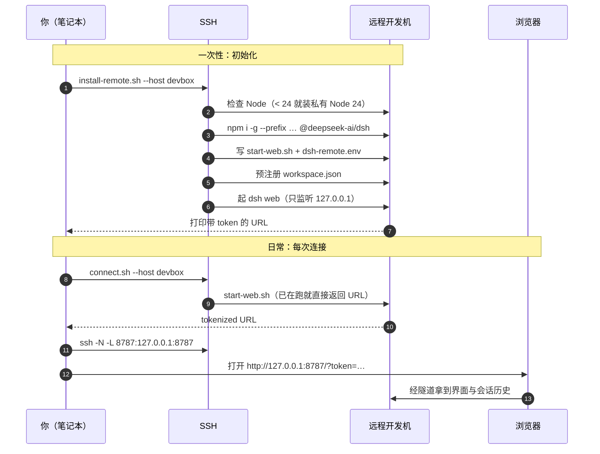

# 架构：为什么把 DSH 装到远端

## 起点：DSH 的「工作区」到底是什么

DSH 的工作区（workspace）在存储里就是一个**本地绝对路径**。以 `$DSH_HOME/storages/workspace.json` 为例：

```json
{
  "unit": { "name": "workspace", "version": 2 },
  "global": { "defaultWorkspaceId": "…", "workspaceIds": ["…"] },
  "tables": {
    "workspaces": {
      "…": {
        "path": "/data/projects/myproj",
        "title": "myproj",
        "sessionIds": ["session-…"],
        "createdAt": "…",
        "updatedAt": "…"
      }
    }
  }
}
```

里面**没有** `host`、`ssh`、`remote` 这类字段。也就是说：

- 工作区必须是**运行 DSH 的那台机器**能直接读写的路径；
- 会话记录（`$DSH_HOME/sessions`）也存在**运行 DSH 的那台机器**上。

推论很直接：想让「工作区 + 对话历史」都待在开发机上、并且换电脑还能接着用，
唯一的做法就是**让 DSH 跑在开发机上**。这就本仓库做的一件事。

## 连接时序

第一次用要装一次；之后每次只是「取 URL + 开隧道」两步，都由一个脚本完成。



换一台电脑时，只有「你」这一列变了，其余三列完全不动 —— 这就是「历史跟着开发机走」的含义。

## 结构

```
┌─────────────────────┐         SSH tunnel          ┌──────────────────────────────┐
│ 你的笔记本 A         │  ssh -L 8787:127.0.0.1:8787 │  远程开发机                   │
│ 浏览器               │ ───────────────────────────▶│  dsh web  127.0.0.1:8787     │
│ 127.0.0.1:8787       │                             │                              │
└─────────────────────┘                             │  ├─ workspace  /data/proj    │
                                                    │  ├─ 会话记录   $DSH_HOME/…   │
┌─────────────────────┐        同一台远程机          │  └─ agent 的 shell 也在这里  │
│ 你的笔记本 B / 手机  │ ───────────────────────────▶│                              │
└─────────────────────┘                             └──────────────────────────────┘
```

关键点：

1. **DSH 进程、工作区、会话历史全在远端**，笔记本只是「显示器 + 键盘」。
2. `dsh web` 只监听 `127.0.0.1`（DSH 刻意拒绝 `--host 0.0.0.0`，因为那等于把远程代码执行能力
   挂到网上）。所以访问一律通过 SSH 隧道，**不需要在远端开放任何端口**。
3. 换电脑只换左边那一半；右边不动，历史自然互通。

## 远端目录布局

`install-remote.sh` 安装后（默认前缀 `$HOME/.dsh-remote-workspace`）：

| 路径 | 作用 |
|---|---|
| `$PREFIX/node/` | 专用 Node ≥ 24（只在系统 node 太旧时安装） |
| `$PREFIX/dsh/` | `@deepseek-ai/dsh` 的 npm 全局前缀，`dsh` 可执行文件在 `bin/dsh` |
| `$PREFIX/dsh-home/` | `DSH_HOME`：会话记录、工作区表、凭据、profile |
| `$PREFIX/dsh-remote.env` | 上面几个路径的配置，供 `start-web.sh` 读取 |
| `$PREFIX/start-web.sh` | 启动/复用 `dsh web` 并打印带 token 的地址 |

全部落在前缀里，**不写系统目录、不改 PATH、不覆盖你已有的 dsh**。删掉前缀目录即完全回滚
（但会话历史也在里面，删之前想清楚）。

## 为什么不走「挂载」或「本地镜像」

| 方案 | 工作区位置 | 会话历史位置 | 换电脑共享 | 说明 |
|---|---|---|---|---|
| **本仓库：DSH 跑在远端** | 远端真实路径 | 远端 | ✅ | 文件操作零同步开销；shell 与你的 tmux/训练同环境 |
| SSHFS / rclone 挂载远程目录 | 本地盘符 | 本地 | ❌ | 适合编辑小文件；大仓库 IO 慢，编译训练仍需 ssh |
| 本地镜像插件（SFTP 同步） | 本地镜像目录 | 本地 | ❌ | 远端无需装东西，多机管理强；但内置读工具看到的是镜像副本 |

三者不冲突，可以并存。选本仓库的场景是：**你已经有一台常年开着的开发机，且希望工作
和上下文都沉淀在它上面。**

## 安全边界

- `dsh web` 只绑 loopback，因此不暴露公网；访问靠 SSH 认证。
- 带 token 的 URL 是**一次性登录凭据**（换 30 天签名 cookie），不要外发、不要贴到聊天里。
- `DSH_HOME` 里有会话历史和凭据文件，建议 `chmod 700`。
- agent 在远端以你的 SSH 用户身份执行命令——它拥有你在这个账号下的全部权限。
  如果远端是 root，那 agent 就是 root。**这是能力也是风险**，务必只在自己的机器上这么干。

关于沙箱：容器化的开发机通常**起不了**命令沙箱（详见
[troubleshooting](./troubleshooting.md#sandbox-backend-unavailable)），
那种情况下需要显式接受 `danger-full-access`。
